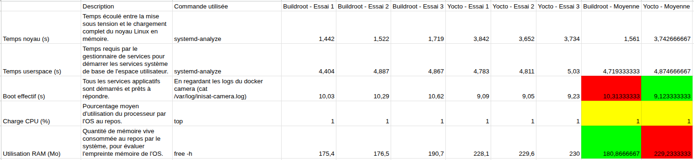

## Présentation

Réalisé à la fin de ma 2ème année d'ingénieur à l'ENSEEIHT (juin à juillet 2026), ce stage portait sur le développement du logiciel de vol embarqué et de l'architecture logicielle d'un kit de nanosatellite pédagogique (INISAT-2UX), articulé autour d'une carte Raspberry Pi Compute Module.

L'objectif était de moderniser la détection d'images terrestres, de comparer les environnements Linux embarqués, d'asservir la roue de réaction pour le contrôle d'attitude et d'interfacer le système avec la cage de Helmholtz.

---

## Détection d'objets

- **Passage à YOLOv8-OBB** : Remplacement de l'ancien modèle YOLOv4 (limité aux avions) par un modèle **YOLOv8-OBB** (*Oriented Bounding Boxes*) pré-entraîné sur le dataset DOTA. Ajout d'une quinzaine de nouvelles classes (avions, bateaux, terrains de sport, piscines, etc.).
- **Optimisation ONNX** : Export du modèle au format `.onnx` et exécution via `onnxruntime` optimisé pour CPU ARM, permettant de réduire le temps d'inférence de 3s à ~1.28s sur le Raspberry Pi.
- **Gestion de la mémoire et Historique Web** : Intégration du conteneur Docker `camera-analyser` et développement d'un module d'historique dans le serveur web. Mise en place d'un nettoyage cyclique pour éviter la saturation de la mémoire.

---

## Comparatif

Nous avons mené une étude comparative pour choisir l'OS embarqué du satellite :

- **Portage et Benchmarks** : Implémentation des briques système sur Buildroot pour être au même niveau que Yocto, puis mesure des métriques (temps de boot, charge CPU, consommation RAM).
- **Problème de caméra sous Buildroot** : Blocage persistant lié à des incompatibilités de bibliothèques multimédia empêchant la récupération du flux vidéo.
- **Bilan** : Choix de **Yocto Linux**, jugé bien plus abouti, modulaire et maintenable pour le logiciel de vol (`obc-soft`).

---

## Asservissement

- **Corrections matérielles sur le PCB** : Modification des connexions physiques sur la carte `obc-soft` afin de relier les broches GPIO manquantes pour piloter la roue à réaction.
- **Régulation par PID** : Refonte de la logique d'asservissement en C++ (remplacement du contrôle en vitesse brute par un **correcteur PID**) afin de pouvoir positionner le satellite selon une consigne d'angle précise.
- **Limites constatées** : Mise en évidence de la dérive progressive du capteur de centrale inertielle **BNO055** lors de rotations répétées.

<!--  -->

---

## Télémétrie

- **Affichage et retour visuel** : Interfaçage avec le système de la cage de Helmholtz (`comLED`) intégrant un écran d'information et un ruban LED.
- **Télémétrie en temps réel** : Affichage dynamique de l'orientation du satellite, des angles mesurés et des données orbitales calculées par l'outil `predict` (azimut, élévation).
- **Code couleur d'état** : Animation dynamique des LEDs selon le mode opérationnel (ex: Jaune pour le pointage solaire, Bleu lors du passage au-dessus de la station sol).

<!--  -->

---

## Limites

- **Balayage de la face station** : Volonté d'implémenter un suivi fluide de la station sol lors des passages en orbite. La faible précision de la roue motrice sur de très faibles incréments d'angle et la dérive du BNO055 n'ont pas permis de valider ce mode en pratique.
- **Problème d'allumage Active Low** : La roue motrice et les magnéto-coupleurs étant pilotés en logique *Active Low*, ils consommaient un courant maximal au démarrage avant l'initialisation des GPIO par l'OBC. Cet appel de courant provoquait la mise en sécurité ou le crash du Raspberry Pi au boot, empêchant l'utilisation des magnéto-coupleurs.
