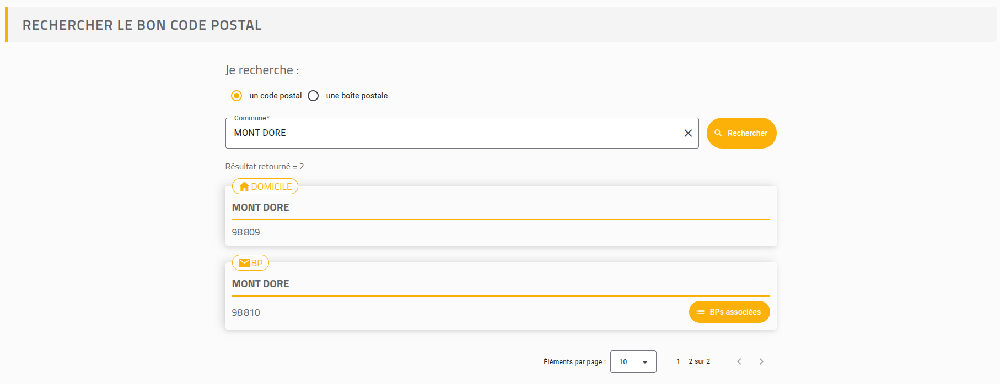
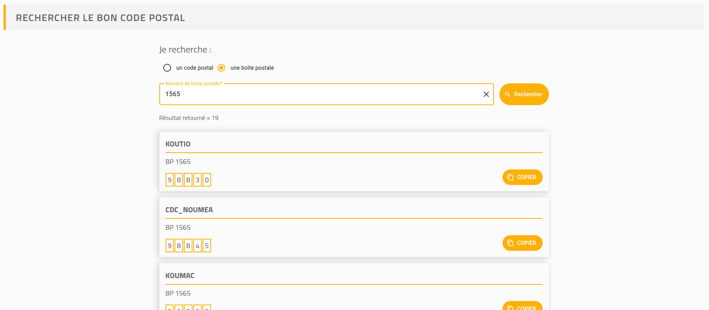

## Contexte du stage

Dans le cadre de ma troisième année de Licence Informatique, j'ai effectué un stage de 2 mois au sein du département **SI Postal** à la Direction des Systèmes d'Information de l'**OPT-NC** (Office des Postes et Télécommunications de Nouvelle-Calédonie).

L'objectif de ce stage était de concevoir et développer une application web interactive de recherche de codes postaux afin de remplacer un tableau statique peu pratique qui était présent sur le site de l'OPT-NC.

---

## Technologies

L'application s'appuie sur une architecture full-stack :

- **Front-end** : Application réactive en **Angular 18** utilisant les composants **Angular Material** déclinés aux couleurs de l'OPT-NC.
- **Back-end** : API RESTful avec **Spring Boot**, documentée via **Swagger UI** et conteneurisée avec **Docker**.
- **Base de données** : **PostgreSQL** avec la création de vues optimisées pour regrouper les données des communes, localités et boîtes postales.
- **CI/CD** : Automatisation du build et du déploiement continu sur **GitHub Pages** via une pipeline **GitHub Actions**.

---

## Fonctionnalités

### Recherche par commune et localité
Mise en place d'un champ de recherche avec auto-complétion et filtres dynamiques (recherche insensible à la casse). 

L'application affiche les codes postaux correspondants en précisant s'ils concernent des domiciles ou des boîtes postales, tout en permettant de consulter les intervalles de numéros de BP associés.

### Recherche par numéro de boîte postale
Développement d'une recherche dédiée par numéro de boîte postale prenant en charge les numéros alphanumériques. 

L'affichage des résultats reprend le format visuel d'une enveloppe postale, intégrant une pagination et une fonction de copie rapide des coordonnées.

### Organisation
- Organisation des tâches au format **Kanban** sur **Jira**.
- Versionnement du code avec gestion de branches et revues de code sous **GitLab** (API) et **GitHub** (Front-end).
- Présentations et ateliers avec les équipes métier pour valider l'expérience utilisateur et intégrer les retours d'utilisation.
